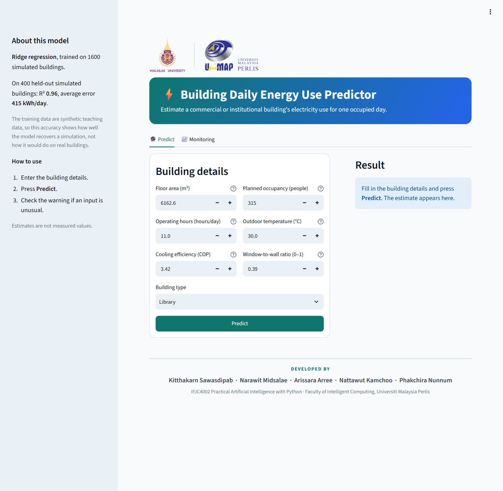
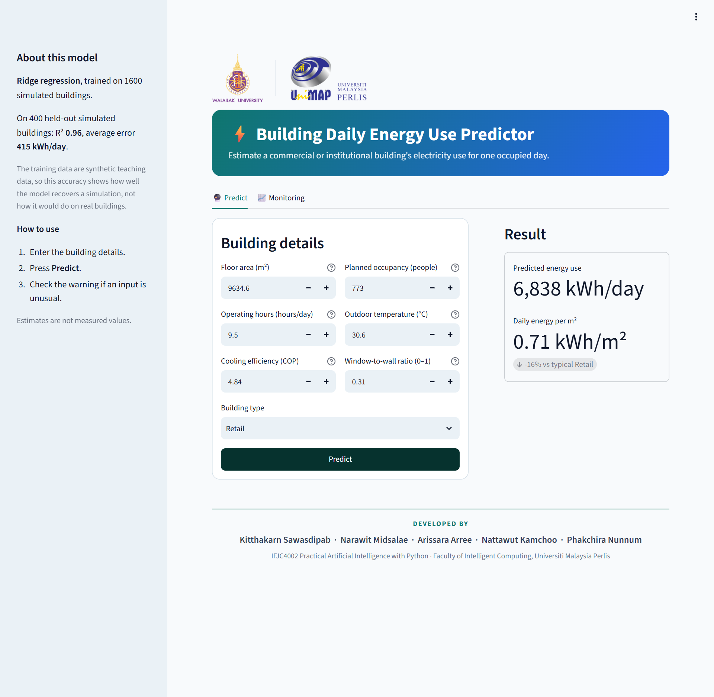
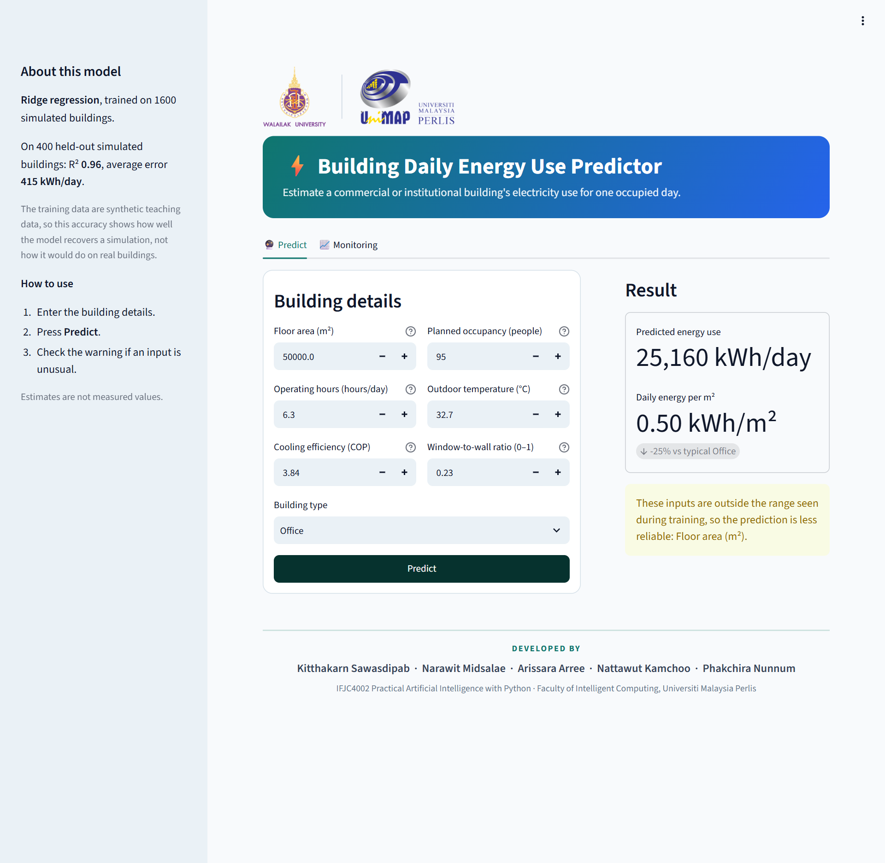
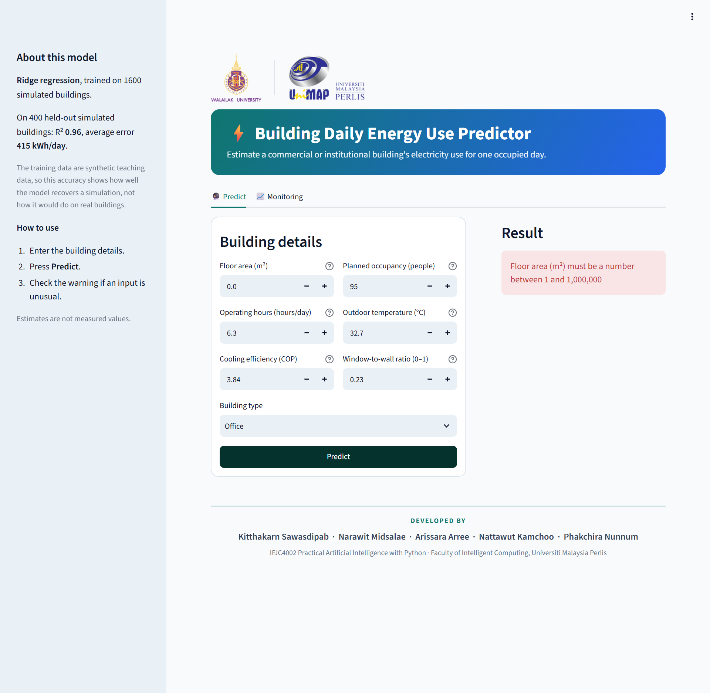
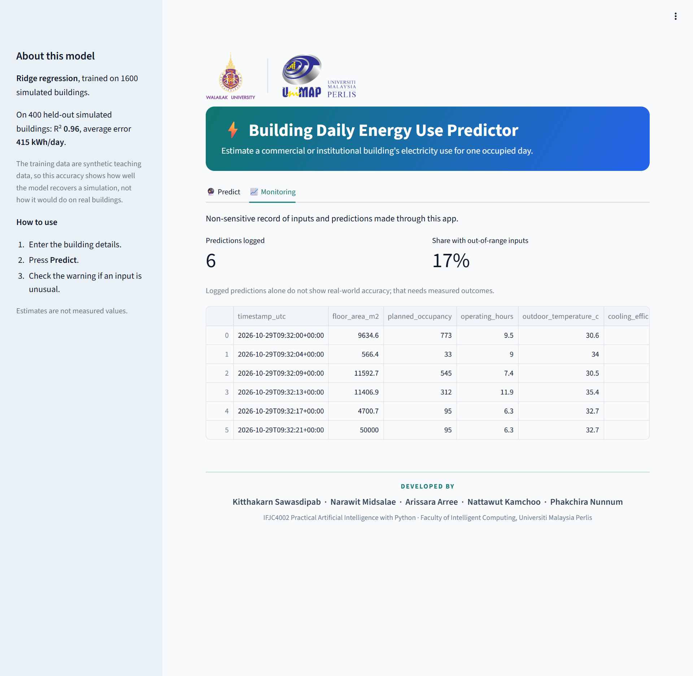

> **Note on the data.** The data are synthetic teaching data, so every accuracy figure in this report describes how well the models recover a simulation, not how they would perform on real buildings.

## 1. Problem definition and dataset analysis (CO1)

### 1.1 Problem, user and benefit
A facility manager or energy analyst planning a day of operation often needs an estimate of how much electricity a building will use, for example to budget, to compare with similar buildings, or to size cooling plans. This project builds a regression model that predicts a building's **daily electricity use (kWh/day)** from seven inputs known in advance, and serves it as a dashboard so a non-programmer can enter a building and get an estimate. The case is different from the household electricity example shown in class: it covers commercial and institutional buildings of four types.

| Item | Definition |
|---|---|
| Intended user | Facility manager or energy analyst |
| Target | Daily electricity use of one building on one occupied day, kWh/day |
| Task type | Regression on tabular data |
| Inputs | Floor area (m²), planned occupancy (people), operating hours (h/day), forecast outdoor temperature (°C), building type (Office, Retail, School, Library), cooling efficiency (COP), window-to-wall ratio (0–1) |
| Prediction setting | A building described only by these inputs; no past readings are used |

### 1.2 Dataset
The data are the course file `04_Building_Energy_Consumption.xlsx` (IFJC4002, Case 4). Its Guide sheet states that it is **synthetic teaching data** (generation seed 20261432): 2,000 simulated occupied days, one for each of 2,000 distinct buildings, "not evidence of real-world accuracy". The identifier `record_id` is excluded from the model.

| Property | Value |
|---|---|
| Rows | 2,000 (2,000 unique ids), one per building |
| Missing values | 16 blank `floor_area_m2` and 16 blank `planned_occupancy`, in 32 different rows (1.6% of rows); target and other inputs complete |
| Values outside the documented ranges | none (checked for area, hours, COP and window ratio) |
| Building types | Office 514, Library 511, School 506, Retail 469: well balanced |
| Target | min 128.9, median 3,835, mean 4,396, max 18,676 kWh/day |

### 1.3 Target distribution and unusual values
Daily energy is moderately right-skewed (skewness 1.05; standard deviation 70% of the mean; Figure 1). The 1st and 99th percentiles are 232 and 13,385 kWh/day. Energy per floor area has a median of 0.65 kWh/m²/day (1st–99th percentile 0.33 to 1.58). No values are impossible; the largest buildings simply use the most energy. The 32 blank inputs are the only data quality problem. Their number is too small to say whether the blanks relate to the target (the mean energy of rows with a blank occupancy is lower, 3,151 against 4,407 kWh/day, but this rests on 16 rows).

*Figure 1. Daily energy use (left), its log10 (middle) and energy per m² (right).*

### 1.4 Features and their relation to the target
Spearman rank correlations with daily energy: floor area **+0.86**, planned occupancy **+0.69**, outdoor temperature +0.29, operating hours +0.27, window-to-wall ratio +0.06, cooling efficiency −0.06 (Figure 2). Four points matter for modelling:
- **Floor area and occupancy are strongly related to each other** (Spearman +0.78), so they carry overlapping information.
- **Spread grows with size.** In the scatter plots the vertical spread widens as area and occupancy increase, a sign that effects are multiplicative rather than additive.
- **Building type shifts energy.** Retail uses the most (mean 5,503 kWh/day, median 0.84 kWh/m²/day) and School the least (3,596; 0.52), although the median areas are similar (about 6,000 m²), so the difference is not caused by size.
- **Weak marginal effects can still matter in combination.** Cooling efficiency and window ratio correlate weakly with energy on their own. The Guide says efficiency affects consumption, so its effect is probably masked by the stronger inputs; we have not tested this for the window ratio.

*Figure 2. Daily energy against each numeric input, with Spearman correlation.*

*Figure 3. Daily energy and energy per m² by building type.*

### 1.5 Suitable approaches and what the data imply
The target is numeric and the data are tabular, so supervised regression is suitable. Because effects look multiplicative, a **linear model on log-transformed variables** is a natural candidate; a **tree ensemble** is the usual alternative when relations are unknown. Consequences of the data: (1) with only 1,600 training rows, a flexible model may struggle to learn a smooth multiplicative surface (we check this in section 3); (2) the 16 + 16 blanks need imputation fitted on training data only; (3) because the data are simulated, a high score shows that a model recovers the simulation, nothing more.

---

## 2. Solution design and preprocessing (CO2)

### 2.1 Workflow
`Excel file → CSV (unchanged) → random 80/20 split → preprocessing fitted on train only → model → 5-fold cross-validation on train → one test evaluation → save one Pipeline → Streamlit form → validation → prediction → log`.

### 2.2 Features and leakage
All seven inputs are known before the predicted day (the Guide describes occupancy as expected and temperature as a forecast), so none reveals the outcome. `record_id` is excluded. The target is never filled. Preprocessing lives inside the same scikit-learn `Pipeline` as the model, so imputers, scalers and encoders are fitted on training data only; an automated test checks that the imputer statistics equal the training-split medians.

### 2.3 Preprocessing
| Step | Treatment | Reason |
|---|---|---|
| Missing area, occupancy | Median imputation, learned on training data | Only 1.6% of rows; keeps all rows |
| Floor area, occupancy | `log1p`, then standardise | Right-skewed sizes; multiplicative effects |
| Hours, temperature, COP, window ratio | Standardise | Scale for the linear model |
| Building type | One-hot, unknown types ignored | Nominal feature |
| Target (Ridge only) | `log1p` on the target, predictions mapped back with `expm1` | Multiplicative structure, see 3.2 |

### 2.4 Split and validation
Every row is a different building, so a random split cannot place one building in both sets (the Guide also specifies a random split). We used 80% for training (1,600 rows) and 20% for testing (400 rows), seed 42; the mean target is similar in both (4,348 and 4,591 kWh/day) and the test set holds 3 rows with blank area and 3 with blank occupancy. Model selection used 5-fold cross-validation on the training set only. The test set was used only to report results, after the candidate models and their settings were fixed (training was re-run several times for code fixes, with identical results).

---

## 3. Model development and comparison (CO2)

### 3.1 Models
| Model | Settings | Role |
|---|---|---|
| Baseline | Predict the training mean | Reference point |
| Ridge regression | alpha = 1.0, log target, log area and log occupancy | Simple, fast, interpretable |
| Random forest | 300 trees, `min_samples_leaf` = 3, raw target, seed 42 | Non-linear alternative |

### 3.2 How the settings were chosen
Before looking at any test result, we compared seven candidate settings by cross-validation **on the training split only** (`notebooks/cv_explore.py`, output saved in `docs/figures/cv_exploration.txt`):

| Candidate | CV RMSE (kWh, mean ± sd) | CV R² |
|---|---|---|
| Ridge, raw target | 1,439 ± 53 | 0.772 |
| **Ridge, log target** | **593 ± 32** | **0.961** |
| Random forest, raw, leaf 3 | 809 ± 85 | 0.928 |
| Random forest, raw, leaf 10 | 960 ± 93 | 0.898 |
| Random forest, log target, leaf 3 | 832 ± 74 | 0.924 |
| Gradient boosting, raw | 712 ± 58 | 0.944 |
| Gradient boosting, log target | 620 ± 61 | 0.958 |

The target transform mattered more than the algorithm: a log target cut Ridge's error by 59%. That fits a multiplicative relation (energy roughly proportional to area, hours and a cooling term). The random forest was best with a raw target and small leaves, and we kept that setting as the second algorithm. Gradient boosting with a log target came close to Ridge but was not better, so the final comparison keeps the two simpler models.

### 3.3 Results
Test set, 400 buildings (CV on the 1,600 training rows in the last column):

| Model | Test MAE (kWh) | Test RMSE (kWh) | Test R² | Median abs. % error | CV RMSE |
|---|---|---|---|---|---|
| Baseline (mean) | 2,515 | 3,244 | −0.01 | 51.0% | 3,020 ± 124 |
| **Ridge regression (log target)** | **415** | **644** | **0.960** | **7.5%** | **593 ± 32** |
| Random forest | 529 | 871 | 0.928 | 9.5% | 809 ± 85 |

Both models beat the baseline clearly (RMSE lower by 80% for Ridge and 73% for the forest). Ridge is better than the forest on every metric, with RMSE 26% lower and MAE 22% lower, and it is faster: fit time about 0.1 s against about 1 s (timings vary between runs and machines). On average a Ridge estimate is within about 9% of the true daily use (MAE 9.0% of the mean).

---

## 4. Final model selection, limitations and improvements (CO2)

### 4.1 Selection
The selection rule coded in `src/train.py` is the lowest cross-validation RMSE on the training set. It selects **Ridge regression** (593 against 809), and the gap is many times larger than the fold-to-fold spread (32 and 85 kWh), so the choice does not depend on the test set. The test results agree. Practical constraints point the same way: Ridge is the faster model, trains in a fraction of a second, and its coefficients can be read directly (4.3).

### 4.2 Error analysis
On the 400 test buildings (Ridge):
- **Bias is small:** mean error −29 kWh (very slight under-prediction); 48% of rows are over-predicted.
- **Typical error:** median absolute error 263 kWh, 90th percentile 926 kWh. In percentage terms the median error is −0.4%, the 5th to 95th percentile range is −16% to +23%, **64.5% of predictions are within 10% and 96.5% within 25%**.
- **Relative error is similar everywhere** (MAE as a share of the mean actual use): 8.7–9.2% across the four building types, 7.8–10.6% across floor-area quintiles, 8.3–10.0% across operating-hour bands, 7.6–10.8% across temperature bands and 7.0–11.1% across COP bands (Figure 5). No group is predicted badly. Ridge beat the forest in each of the four building types.
- **Absolute error grows with the level of energy**: MAE is 89 kWh in the lowest predicted-value quintile and 888 kWh in the highest, while the relative error stays near 8–10%. This means the noise is roughly proportional to size, as in a multiplicative model, and explains why a log target helps.
- **Largest errors are mostly Retail buildings with high energy use:** the ten worst predictions are 1,800–3,300 kWh off; six are Retail; eight are under-predictions. The 5% worst predictions carry 24% of the total absolute error.
- **Rows with a blank input:** the test set has 6 such rows, with MAE 787 kWh (19.6% of their mean) against 409 kWh (8.9%) for complete rows. This is consistent with median imputation losing information, but six rows are too few to conclude.

*Figure 4. Ridge: predicted against actual, residuals against predicted, and percentage error.*

*Figure 5. MAE as a percentage of the mean actual use, by building type, floor-area quintile, operating hours and predicted level.*

### 4.3 What the models use
Permutation importance on the test set (increase in RMSE when a feature is shuffled; Ridge): floor area 2,799 kWh, operating hours 1,193, outdoor temperature 1,043, building type 751, cooling efficiency 313, window ratio 89, **occupancy 30**. The forest ranks them the same way. Occupancy has almost no importance even though it correlates +0.69 with energy, because it is closely related to floor area (+0.78) and adds little once area is known; the same explanation applies to its small Ridge coefficient. This is our interpretation and was not tested, for example by removing area from the inputs.

Ridge coefficients (log scale, for +1 standard deviation of each input): floor area +121% energy, Retail +26%, operating hours +25%, outdoor temperature +23%, window ratio +4%, occupancy +3%, cooling efficiency −7%, School −17%. In plain units, one extra operating hour or one extra °C each raise predicted use by roughly 5%.

<figure class="narrow"><figcaption>Figure 6. Permutation importance, Ridge.</figcaption></figure>

### 4.4 Limitations
- **The data are simulated.** The models learn the simulation's rules, so the high accuracy (R² 0.96) is not evidence of real-world accuracy. Real buildings add effects absent from the file (equipment, weather history, behaviour, faults).
- **Narrow data coverage.** All temperatures are 23–37 °C, all areas 258–11,989 m², and one day per building. Outside these ranges the model extrapolates by formula. For example at −40 °C it predicts only 111 kWh/day for a median Office, because it scales energy up by about 5% per °C and cannot represent heating; at 1,000,000 m² it gives 570,777 kWh/day. The dashboard flags such inputs as outside the training range, and they should not be trusted.
- Only 1,600 training rows and four building types; no repeated measurements of the same building.
- Blank inputs are filled with the training median, which loses information (4.2).
- Monitoring can show shifts in the inputs but not accuracy; that needs measured outcomes.

### 4.5 Improvements (linked to findings)
1. **Validate on real, measured data.** This is the main gap; the same pipeline can be re-trained on real records.
2. **Tune Ridge's regularisation by cross-validation** and test interactions such as area × operating hours; we kept alpha = 1.0 and did not tune it.
3. **Handle blanks better** (for example a "was missing" indicator or model-based imputation), since rows with a blank input had double the error (4.2), after collecting enough rows to check this.
4. **Report an uncertainty range.** Errors are about ±20% (5th–95th percentile −16% to +23%), so showing a range next to the single value would be more honest.
5. **Check the occupancy data.** If occupancy adds nothing beyond floor area, it may be redundant or measured poorly.

---

## 5. Implementation, dashboard, deployment, testing and monitoring (CO3)

### 5.1 Implementation
Python code in `src/`: `prepare_data.py` (Excel to CSV), `train.py` (training and comparison), `predict.py` (validation and prediction), `monitor.py` (logging). The trained Pipeline (preprocessing plus model) is saved with `joblib` in `models/model.joblib` together with `metadata.json` (feature order, training ranges and medians, categories, results). The dashboard loads the same Pipeline, so the transformations and the feature order are identical to training. Dependencies are in `requirements.txt` and seeds in `src/config.py`.

### 5.2 Dashboard
The Streamlit dashboard (Figures 7 to 11) has a title banner and two tabs. A sidebar, "About this model", gives the model's accuracy on the held-out buildings and warns that the training data are synthetic. The Predict tab has a form on the left with six number inputs and a building-type drop-down, and a result card on the right. The card shows the predicted energy in kWh/day and the daily energy per m², compared with the typical value of the chosen building type. A header strip shows the logos of Walailak University and Universiti Malaysia Perlis, and a footer lists the five developers. The screenshots were taken from the deployed app on 29 October 2026.

<figure><figcaption>Figure 7. The dashboard before a prediction.</figcaption></figure>
<figure><figcaption>Figure 8. Reference building 1 (Retail): 6,838 kWh/day, the same as in the notebook.</figcaption></figure>

**Input validation.** Each numeric input has a physical hard limit: area 1–1,000,000 m², occupancy 0–100,000, operating hours 0–24, temperature −40 to 55 °C, COP 1–10, window ratio 0–1. The building type must be one of the four training categories and no field may be empty. Values inside these limits but outside the range seen in training (for example an area above 11,989 m²) are accepted with a warning that the prediction is less reliable. All inputs sit inside one Streamlit form, and the widgets have no limits of their own, so every value reaches our validation function and a clear message is shown.

### 5.3 Deployment
The app is deployed from the GitHub repository on Streamlit Community Cloud: https://building-energy-predict.streamlit.app/. After the switch to the new dataset the app was rebooted and loads the new model (checked on 2026-10-29). A reboot is needed because the running process can keep old modules after a push (we saw an `ImportError` from this).

### 5.4 Testing
Full log: `docs/test_log.md`. 35 automated `pytest` tests pass.
- **Dashboard vs notebook:** five test buildings entered through the app form matched the training script's predictions (for example 6,838 vs 6,837.80 kWh/day), differing only by rounding to whole kWh.
- **Boundary:** every numeric input at both of its hard limits is accepted.
- **Invalid:** zero or negative area, negative occupancy, 30 operating hours, temperatures of 99 and −80 °C, COP 0.2, window ratio 2, an unknown building type, text instead of a number and blank values are rejected with a clear message, no prediction is shown and nothing is logged.
- **Missing data and leakage:** the model predicts with blank area and occupancy (median imputation), and its imputer statistics equal the training-split medians.
- **Problem found and fixed:** in the first deployed version, an invalid entry in the browser left the previous result on screen. We moved the inputs into a form without widget limits.
- **Deployed app, in a browser (29 October 2026):** the five notebook reference buildings were entered in the live form (table below). A zero floor area and a temperature of 99 °C each gave a clear error and no result (Figure 10). A 50,000 m² building gave 25,160 kWh/day with the out-of-range warning (Figure 9). An earlier manual attempt returned a different value because the building type had been typed but not selected from the list, a mistake in how we tested, not in the app.

| Reference building | Type | Notebook (kWh/day) | Live dashboard (kWh/day) |
|---|---|---|---|
| 1 | Retail | 6,837.80 | 6,838 |
| 2 | School | 336.49 | 336 |
| 3 | School | 5,389.53 | 5,390 |
| 4 | Retail | 12,676.13 | 12,676 |
| 5 | Office | 2,566.35 | 2,566 |

The dashboard rounds to whole kWh, so every difference is rounding only.

<figure><figcaption>Figure 9. A 50,000 m² input is outside the training range: a prediction is shown with a warning.</figcaption></figure>
<figure><figcaption>Figure 10. A floor area of 0 is rejected with a clear message and no result.</figcaption></figure>

### 5.5 Monitoring
Each valid prediction is appended to a log (time, inputs, prediction, list of out-of-range inputs) without personal data; invalid entries are not logged. The Monitoring tab shows the number of predictions, the share of requests with inputs outside the training range, and the latest records (Figure 11). **Review trigger:** more than 20% of requests outside the training range, which would suggest that users' buildings differ from the data and the model needs reviewing or retraining.

In the deployed test session the tab showed 6 logged predictions with 17% out of range (1 of 6). All 6 were our own test requests: the five reference buildings and one 50,000 m² building. The share is below the 20% trigger, so no review message appeared. With so few requests a single test input moves the share a lot, so the trigger should be read only after a reasonable number of requests. The free hosting does not keep the log permanently, so the screenshot is the lasting record. New predictions alone do not show real-world accuracy; that needs measured energy use to compare against.

<figure class="wide"><figcaption>Figure 11. The Monitoring tab after the test session.</figcaption></figure>

---

## 6. Conclusion
We built and deployed a regression system that predicts a building's daily electricity use from seven inputs, using the course's synthetic dataset of 2,000 buildings. A log-target Ridge regression, chosen by cross-validation on the training data, reached R² 0.960 and a median error of 7.5% on 400 held-out buildings, clearly ahead of a random forest (R² 0.928) and of the mean baseline. Errors are proportional to building size and similar across building types, and the model relies mainly on floor area, operating hours, temperature and building type. Because the data are simulated, the accuracy shows that the model recovers the simulation, not that it would work on real buildings. The most important next step is to validate it on measured data.

## References
- IFJC4002 course file `04_Building_Energy_Consumption.xlsx` (synthetic teaching data; generation seed 20261432), Faculty of Intelligent Computing, Universiti Malaysia Perlis. Course coordinator: Ir. Dr. Marni Azira Markom.
- Pedregosa, F., et al. (2011). Scikit-learn: Machine learning in Python. *Journal of Machine Learning Research*, 12, 2825–2830.
- Streamlit documentation, https://docs.streamlit.io

## Appendices

### Appendix A. Group members
- Kitthakarn Sawasdipab
- Narawit Midsalae
- Arissara Arree
- Nattawut Kamchoo
- Phakchira Nunnum

### Appendix B. AI-assisted development record
**Tool used:** Claude Code (Claude Sonnet 5.5). The brief names ChatGPT as an example of allowed coding support; the group should confirm with the lecturer that this tool is acceptable.

The prompts were typed in Thai as short instructions during the working session. To make the table easy to read, the **"Task requested"** column restates each prompt in English. The **"Original prompt"** column keeps the exact Thai text as evidence. The last column lists only what was actually checked or corrected in that session.

The project went through two versions. Rows 2 to 6 and 8 describe the first version, built on the public BDG2 dataset; row 9 is the switch to the lecturer-provided dataset, which replaced it. The BDG2 version stays in the Git history.

| # | Stage | Task requested (English summary) | Original prompt (verbatim, Thai) | What the AI produced | How it was checked, corrected or adapted |
|---|---|---|---|---|---|
| 1 | Understanding the brief | Read the project brief (PDF) and summarise the required tasks, deliverables and assessment criteria. | อ่านไฟล์และสรุปมา ว่าโปรเจ็คนี้ให้ทำอะไรบ้าง | A Thai summary of tasks, deliverables and the rubric. The built-in PDF reader returned no text, so the AI extracted it with `pdftotext`. | The deliverables list and rubric weights were copied from the extracted text and compared with the summary. |
| 2 | Case and dataset selection | Select Case 4 (building energy consumption prediction) and propose an approach and candidate datasets. | เลือกหัวข้อ 4 | A plan for case 4 and three public dataset candidates (BDG2, ASHRAE GEPIII, UCI Appliances). | The AI stated that the licence and links were unchecked, then read the file sizes and licence from the BDG2 repository (CC BY-SA 4.0) and asked permission before downloading. |
| 3 | Project design and implementation | Create the project scaffold: training pipeline, Streamlit dashboard, input validation, monitoring and tests. | เริ่มสร้างโปรเจ็คได้เลย | Project layout, `train.py`, `predict.py`, `monitor.py`, `app.py`, tests and document templates. | Ran 11 pytest tests and a headless run of the app on synthetic demo data. Fixed a deprecated Streamlit argument. |
| 4 | Data preparation and modelling (first version, BDG2 data) | Build the dataset from the public source without waiting for the lecturer's data, then train and compare models. (Permission to download three BDG2 files was given in a follow-up message.) | ช่วยทำ data set ให้เลย ไม่ต้องรออาจารย์ส่ง data แล้ว / อนุญาตให้ดาวน์โหลดทั้ง 3 ไฟล์จาก BDG2 ได้เลย | A script turning hourly BDG2 meters into a daily table, then baseline, Ridge and random forest models. | The first forest scored R² ≈ 0 (it memorised buildings through floor area); a log target and large leaves fixed it, and Ridge with a log target became unstable (R² −6.3) until floor area was also log-transformed. Test results were printed at each attempt, so the test set was not untouched in that version. The first data script crashed (a pandas 3 `groupby.apply` dropped a column) and was rewritten. |
| 5 | Testing the dashboard | Commit the work and test the dashboard against the trained model. | commit ได้เลย แล้วทดสอบแอปกับโมเดลจริงด้วย | A headless test of the app with the real model. | Five reference cases matched the notebook. The test tool could not submit out-of-limit values, so the AI reported this as not proven, tested the validator directly, and later checked the deployed app in a browser. |
| 6 | Analysis and reporting (first version) | Create an EDA and error-analysis notebook, and draft the report using the real training results. | สร้าง notebook EDA และ error analysis สำหรับรายงาน / ร่างรายงานตามโครงใน docs/report_outline.md โดยใช้ตัวเลขจริงจากการเทรน | An analysis notebook, figures, `results.json` and a report draft. | The notebook re-trained the models and asserted that its RMSE matched the saved metadata. The draft was cross-checked against `results.json` and four statements were corrected. |
| 7 | Deployment | Provide the steps to push the project to GitHub and deploy it on Streamlit Community Cloud. | ขอขั้นตอน | Step-by-step instructions for pushing to GitHub and deploying on Streamlit Community Cloud. | The group followed the steps and obtained the live app. The deployed app was then opened and its output compared with the notebook. |
| 8 | Fixing a weakness found in testing | Fix the weakness where the Predict button reuses the previous values after an invalid entry. | แก้จุดอ่อนที่ปุ่ม Predict ใช้ค่าเก่าได้เลย | Inputs moved into `st.form` without widget limits, clearer error messages and app-level tests. | A browser test of the deployed app had shown that an invalid entry left the previous result on screen. The fix was checked with new automated tests and in a browser on a local server. After the push the deployed app failed with an `ImportError` because the running process kept an old module; rebooting the app fixed it. |
| 9 | Switching to the lecturer's dataset | Switch the project to the lecturer-provided dataset (`04_Building_Energy_Consumption.xlsx`). | ใช้ dataset ใหม่ | New data loader, a seven-feature pipeline, a new dashboard form, 35 tests, a new analysis notebook and updated documents. | The file's Guide sheet was read and followed (exclude the ID, split before preprocessing). Model settings were chosen by cross-validation on the training split only, before any test result was seen, and the comparison was saved in `docs/figures/cv_exploration.txt`. A reference case with a blank floor area was found and replaced. |

**Weaknesses found in the AI's own work** (evidence of checking): the pandas 3 crash, the memorising forest, the unstable Ridge, the Predict button reusing old values, and a reference case that did not test what it claimed to.

### Appendix C. Test log
#### C.1 Dashboard vs notebook (from `models/reference_cases.csv`, complete test rows)
Entered through the app form (Streamlit `AppTest`, real saved model):

| # | Inputs (area m², occupancy, hours, °C, COP, window ratio, type) | Notebook prediction | Dashboard prediction | Match? |
|---|---|---|---|---|
| 1 | 9634.6, 773, 9.5, 30.6, 4.84, 0.31, Retail | 6837.80 | 6,838 kWh/day | Yes |
| 2 | 566.4, 33, 9.0, 34.0, 3.48, 0.30, School | 336.49 | 336 kWh/day | Yes |
| 3 | 11592.7, 545, 7.4, 30.5, 2.87, 0.21, School | 5389.53 | 5,390 kWh/day | Yes |
| 4 | 11406.9, 312, 11.9, 35.4, 3.21, 0.17, Retail | 12676.13 | 12,676 kWh/day | Yes |
| 5 | 4700.7, 95, 6.3, 32.7, 3.84, 0.23, Office | 2566.35 | 2,566 kWh/day | Yes |

The dashboard rounds to whole kWh, so differences below 0.5 are rounding only. (An earlier reference set contained a row with a blank floor area,
which the form cannot take; the training script now picks reference rows with complete data.)

#### C.2 Typical, boundary and invalid inputs
Automated with `pytest` (35 tests: `tests/test_pipeline.py` for the validation function and `tests/test_app.py` for the app form).

| # | Type | Input | Expected behaviour | Result |
|---|---|---|---|---|
| 1 | Typical | default form values (training medians); a 5000 m², 300 people, 10 h building | Prediction in kWh/day, no warning | Pass |
| 2 | Boundary | each numeric input at its lower and upper hard limit (area 1 and 1,000,000; occupancy 0 and 100,000; hours 0 and 24; temperature −40 and 55; COP 1 and 10; window ratio 0 and 1) | Accepted (limits are inclusive) | Pass (validation function) |
| 3 | Out of range | area 50,000 m² (training range 258–11,989) | Prediction plus a warning that it is less reliable | Pass (app form) |
| 4 | Invalid | area 0 or −5 | Clear error, no prediction, nothing logged | Pass (app form) |
| 5 | Invalid | occupancy −10; hours 30; temperature 99 or −80; COP 0.2; window ratio 2 | Clear error, no prediction | Pass (app form) |
| 6 | Invalid | unknown building type; blank area; text "hot" for temperature | Rejected with a message | Pass (validation function) |
| 7 | Missing data | model asked to predict with blank floor area and occupancy (the training data has such rows) | Imputed with training medians, finite prediction | Pass |
| 8 | Leakage | imputer statistics compared with training-split medians | Equal to the training medians, not the full-data medians | Pass |

Examples of the messages: "Floor area (m²) must be a number between 1 and 1,000,000"; "Outdoor temperature (°C) must be a number between -40 and 55".

**Behaviour at extreme inputs** (Office, other inputs at the training medians; checked by calling the model, not through the browser):
the model gives 7,980 kWh/day at 12,000 m² and 570,777 kWh/day at 1,000,000 m², which scales roughly with size. At −40 °C it gives only
111 kWh/day, because the data only cover 23–37 °C and the model scales energy up by about 5% per °C: it cannot represent heating in the cold. These inputs are inside the hard limits, so they are accepted with an
out-of-range warning, and **the prediction must not be trusted**.

#### C.3 Deployed app, checked in a browser (2026-10-29, current dashboard design)
A scripted Chrome session (Playwright) filled the live form and pressed Predict. It entered the five reference buildings of section A, then three further cases.

| # | Input | Expected | Actual | Pass? |
|---|---|---|---|---|
| C1 | Reference 1: Retail, 9634.6 m² … | 6,838 kWh/day (notebook 6837.80) | 6,838 kWh/day | Pass |
| C2 | Reference 2: School, 566.4 m² … | 336 (notebook 336.49) | 336 kWh/day | Pass |
| C3 | Reference 3: School, 11592.7 m² … | 5,390 (notebook 5389.53) | 5,390 kWh/day | Pass |
| C4 | Reference 4: Retail, 11406.9 m² … | 12,676 (notebook 12676.13) | 12,676 kWh/day | Pass |
| C5 | Reference 5: Office, 4700.7 m² … | 2,566 (notebook 2566.35) | 2,566 kWh/day | Pass |
| C6 | Last case with floor area = 50,000 m² (training range 258–11,989) | Prediction plus out-of-range warning | 25,160 kWh/day and "…less reliable: Floor area (m²)." | Pass |
| C7 | Floor area = 0 | Clear error, no prediction | "Floor area (m²) must be a number between 1 and 1,000,000"; no result card | Pass |
| C8 | Temperature = 99 °C | Clear error, no prediction | "Outdoor temperature (°C) must be a number between -40 and 55"; no result card | Pass |
| C9 | Monitoring tab afterwards | Counts valid predictions only | 6 logged, 17% out of range, no review message | Pass |

Screenshots: `01_dashboard_form.png`, `02_result_typical.png`, `03_warning_out_of_range.png`, `04_error_zero_area.png`, `05_error_temperature.png`, `06_monitoring.png`.

**Notes**
1. The log holds 6 entries: the 5 reference buildings and 1 out-of-range request, one of them out of range (17%). The invalid entries (C7, C8) were not logged, as intended. All 6 are our own test requests. (The log started empty because the app had just been rebooted.)
2. An earlier manual check on the same day, before the redesign, gave the same reference result for case 1. Its first attempt returned a different value because the text "Retail" had been typed into the building-type box without choosing the option, so the form still held the default (Library). Anyone testing by hand must pick the option from the list.
3. In the scripted run the entered values do not need Enter: the form sends everything when Predict is pressed.

#### C.4 Monitoring observations
| Date | Predictions logged | Out-of-range share | Observation / action |
|---|---|---|---|
| 2026-10-29 (deployed app, after the checks in C) | 6 | 17% (1 of 6) | The one out-of-range request was the deliberate 50,000 m² test. Below the 20% review trigger, so no review message. With so few requests one test input moves the share a lot. |

Review trigger: more than 20% of logged requests have inputs outside the training range. The trigger is only meaningful after a reasonable number of requests.
The free hosting does not keep the log for ever, so the screenshot is the lasting record. Logged predictions do not show real-world accuracy without measured energy use to compare.

### Appendix D. Code and data
Repository: https://github.com/kitthakarn-sawasdipab/AI-Project. Analysis notebook: `notebooks/analysis.ipynb`; figures and numbers: `docs/figures/`; candidate comparison: `docs/figures/cv_exploration.txt`; dashboard screenshots: `docs/screenshots/`.
